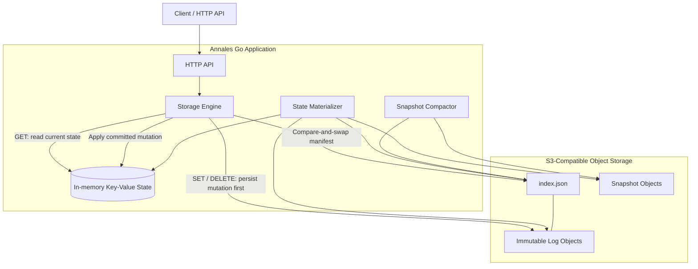

# Annales

**An S3-backed, RAM-first key-value store written in Go.**

Annales is an experimental key-value storage engine that combines the read performance of in-memory state with the durability of S3-compatible object storage. It maintains the current key-value state in RAM, records mutations in an append-only log, and reconstructs state from durable storage when the application restarts.

The project explores an alternative to keeping all durable application data inside a traditional database or relying on an in-memory data store as the primary storage layer.

> **Status:** Experimental. Persistence, API operation, Docker deployment, and recovery after an application-container restart have been manually verified. Comprehensive integration tests, snapshot recovery validation, multi-instance consistency, and performance benchmarks remain planned work.

## Table of contents

- [Why Annales?](#why-annales)
- [Architecture](#architecture)
- [How it works](#how-it-works)
- [Why S3 instead of Redis?](#why-s3-instead-of-redis)
- [Potential use cases](#potential-use-cases)
- [Technology stack](#technology-stack)
- [Getting started](#getting-started)
- [API reference](#api-reference)
- [Configuration](#configuration)
- [Development](#development)
- [Limitations and roadmap](#limitations-and-roadmap)

## Why Annales?

Many applications need fast access to frequently used data without sacrificing durability. Traditional approaches often involve maintaining an in-memory cache alongside a separate persistent database, or using an in-memory data store with persistence enabled.

Annales explores a different arrangement:

- **RAM for reads:** Keep the current key-value state in memory to avoid fetching objects from storage for every read.
- **Object storage for durability:** Persist mutations as immutable log objects and maintain a manifest identifying the current log position.
- **Recovery after restart:** Reconstruct the in-memory state from the manifest, snapshots, and log history.
- **S3-compatible storage:** Keep the storage interface separate from the engine so different compatible object-storage backends can be considered.
- **Simple deployment:** Use Docker Compose to run the API and MinIO together.

The goal is not to eliminate databases or replace every Redis use case. It is to investigate when a RAM-first application backed by object storage can provide a useful balance of simplicity, durability, and infrastructure flexibility.

## Architecture



The diagram shows the intended architecture. Snapshot creation and recovery are implemented in the codebase, but still require dedicated integration tests before being considered fully verified.

### Main components

| Component | Responsibility |
|---|---|
| HTTP API | Exposes health and key-value endpoints. |
| Engine | Coordinates writes, reads, and the in-memory state. |
| In-memory state | Holds the current key-value mapping for fast reads. |
| Append-only log | Records `SET` and `DELETE` operations as durable log batches. |
| Manifest | Tracks the current log sequence, current log key, and snapshot sequence. |
| Materializer | Reconstructs state from a snapshot and subsequent log history. |
| Compactor | Creates snapshots and advances the manifest to reduce recovery work. |
| Object-storage interface | Separates storage operations from the engine's business logic. |
| MinIO | Provides local S3-compatible object storage for development. |

## How it works

### 1. Startup and recovery

When Annales starts, it initializes the storage client and engine before accepting API requests.

The engine reads the manifest, loads an applicable snapshot if one exists, and replays the remaining log history to reconstruct the current key-value state in RAM.

### 2. Reading a value

A `GET` request reads the in-memory state. It does not need to replay the object-storage logs on every request.

This avoids a network object-storage operation for each ordinary read.

### 3. Writing a value

A `SET` or `DELETE` operation follows the intended durable-write sequence:

1. Append a new immutable log object.
2. Advance the manifest using conditional updates to coordinate concurrent append attempts.
3. Apply the committed mutation to the in-memory state.

The engine updates its local RAM state only after the storage append succeeds.

### 4. Snapshotting and compaction

As the log history grows, replaying every historical operation can increase startup time. Snapshots provide a way to store a materialized representation of state at a particular sequence.

After a snapshot is committed and the manifest advances, recovery can load the snapshot and replay only the subsequent operations.

Old log cleanup and recovery behavior must be validated carefully before relying on compaction for production workloads.

### 5. Persistence across restarts

The in-memory state is temporary; the manifest, logs, and snapshots are stored in object storage.

When the application restarts, it reconstructs the state from those durable objects. The Docker deployment uses a persistent MinIO volume so container recreation does not automatically erase stored data.

## Why S3 instead of Redis?

Redis and Annales make different architectural trade-offs.

Redis is a mature, low-latency in-memory data store with a broad feature set and persistence options. Annales is an experimental design that uses RAM for its active state while placing the durable log and snapshots in S3-compatible object storage.

| Dimension | Redis | Annales |
|---|---|---|
| Primary design | In-memory data store | RAM-first state with object-storage durability |
| Reads | Optimized for low-latency access | Reads from local in-memory state |
| Durable data | Supports persistence mechanisms such as RDB snapshots and AOF | Stores logs, manifest, and snapshots in S3-compatible storage |
| Recovery | Uses Redis persistence and recovery mechanisms | Reconstructs RAM state from manifest, snapshots, and logs |
| Storage infrastructure | Redis deployment and its configured persistence infrastructure | An S3-compatible object-storage backend |
| Storage interface | Redis commands and data structures | Application-specific key-value API and object-storage abstraction |
| Feature maturity | Mature ecosystem, rich data structures, tooling, and operational features | Experimental, focused on a narrow key-value API |
| Multi-instance behavior | Provides established replication and clustering options | Distributed cache consistency and multi-instance coordination remain unfinished work |
| Performance | Well-established high-performance data store | Requires workload-specific benchmarking; no performance advantage is claimed |
| Best fit | General-purpose low-latency data storage, caching, and supported data structures | Exploring a durable object-storage-backed key-value architecture |

### What does Annales offer?

The main idea is **separating the active working state from the durable storage layer**.

Potential benefits include:

- Using object storage as the durable home for log history and snapshots.
- Keeping ordinary reads local to the application process.
- Avoiding an object-storage request for every `GET`.
- Using immutable log objects and conditional manifest updates to coordinate appends.
- Exploring object-storage economics and recovery behavior for suitable workloads.
- Keeping the storage interface adaptable to different S3-compatible providers.

These are architectural goals, not yet proven advantages in every workload.

### What does Redis provide that Annales does not?

Redis offers much more than simple key-value operations. Depending on the deployment and version, it supports richer data structures, atomic operations, expiration, replication, clustering, mature client libraries, and extensive operational tooling.

Annales does not currently aim to reproduce that feature set. Its API is deliberately small, and its multi-instance consistency, scalability, fault recovery, and performance characteristics need further engineering and testing.

**Annales is not a drop-in Redis replacement.** Redis may remain the better choice when an application needs its existing ecosystem, advanced data structures, mature replication, or established production guarantees.

## Potential use cases

These are candidate workloads to investigate, not claims that Annales is already production-ready for each one.

### 1. Metadata and configuration stores

Applications can keep a relatively small working set of metadata or configuration values in RAM while storing the durable operation history in object storage.

Examples include application metadata, internal configuration records, and non-critical coordination data where the required consistency guarantees are well understood.

### 2. Durable state for internal services

An internal service may need a small key-value interface but prefer to keep durable history in an object-storage system already used by the organization.

Annales could be evaluated when a narrow API and simple data model are sufficient.

### 3. Ingestion and event-processing metadata

A service processing incoming events may need to maintain checkpoints, processing metadata, or mappings in memory while recording changes durably.

This would require explicit evaluation of write throughput, concurrent updates, recovery guarantees, and the consequences of failed or retried operations.

### 4. Research into object-storage-backed databases

Annales is well suited as a learning and research project for exploring:

- Write-ahead or append-only logging.
- Conditional updates and compare-and-swap.
- Snapshotting and log compaction.
- Recovery after crashes and restarts.
- The trade-offs between memory, object storage, and recovery time.
- Performance and cost comparisons against Redis and other storage systems.

### 5. Applications with infrequent writes and frequent reads

Workloads with a manageable in-memory working set and relatively infrequent mutations are interesting candidates for evaluation.

The design avoids object-storage requests for ordinary reads, but write latency, memory requirements, startup replay time, and consistency requirements still determine whether the approach is suitable.

### When Annales is not a good fit

It is not currently a good choice for applications requiring:

- A proven multi-node, strongly consistent database.
- Redis-compatible commands or advanced data structures.
- High availability and failover guarantees.
- Unbounded data sets that cannot fit in application RAM.
- Production guarantees that have not yet been established by testing.

## Technology stack

- **Language:** Go
- **HTTP server:** Go standard library
- **Object storage:** S3-compatible API
- **Local object storage:** MinIO
- **S3 client:** AWS SDK for Go v2
- **Deployment:** Docker and Docker Compose
- **Persistence model:** Immutable log objects, a conditional-update manifest, and snapshots

## Getting started

### Prerequisites

Install:

- [Git](https://git-scm.com/)
- [Docker Desktop](https://www.docker.com/products/docker-desktop/) or Docker Engine with Docker Compose
- `curl` and `openssl` for the setup script

You do not need to install Go just to run the containerized application.

### 1. Clone the repository

Replace the placeholder URL with the actual repository URL:

```bash
git clone <your-repository-url>
cd Annales
```

### 2. Start Annales

```bash
chmod +x run.sh
./run.sh
```

The script checks prerequisites, creates a local `.env` file if one does not already exist, builds the application image, starts MinIO, initializes the bucket, starts Annales, and waits for the health endpoint.

Existing `.env` configuration is preserved on subsequent runs.

### 3. Verify the API

```bash
curl -i http://localhost:8080/health
```

Expected response:

```http
HTTP/1.1 200 OK
Content-Type: application/json

{"status":"ok"}
```

### 4. Write and read a value

```bash
curl -i -X PUT http://localhost:8080/kv/greeting \
  -H 'Content-Type: application/json' \
  -d '{"value":"Hello from Annales"}'
```

Expected: `204 No Content`.

Read it back:

```bash
curl -i http://localhost:8080/kv/greeting
```

Expected response:

```json
{
  "key": "greeting",
  "value": "Hello from Annales"
}
```

### 5. Stop the application

```bash
./run.sh down
```

This removes the Compose containers and network while preserving the named MinIO data volume.

Start the application again:

```bash
./run.sh
```

Then repeat the `GET` request to verify that the value is recovered.

**Warning:** `docker compose down -v` removes the named data volume and can permanently delete your local MinIO data. Do not use it unless you intentionally want to reset the development environment.

## API reference

The current API is intentionally small.

| Method | Endpoint | Purpose | Successful response |
|---|---|---|---|
| `GET` | `/health` | Check API health | `200 OK` |
| `PUT` | `/kv/{key}` | Create or update a value | `204 No Content` |
| `GET` | `/kv/{key}` | Retrieve a value | `200 OK` |
| `DELETE` | `/kv/{key}` | Delete a value | `204 No Content` |

### Store or update a value

```bash
curl -i -X PUT http://localhost:8080/kv/user:42 \
  -H 'Content-Type: application/json' \
  -d '{"value":"Alice"}'
```

### Retrieve a value

```bash
curl http://localhost:8080/kv/user:42
```

Example response:

```json
{
  "key": "user:42",
  "value": "Alice"
}
```

### Delete a value

```bash
curl -i -X DELETE http://localhost:8080/kv/user:42
```

### Handle a missing key

A request for a missing key returns `404 Not Found`.

```bash
curl -i http://localhost:8080/kv/does-not-exist
```

The current API stores string values and exposes a deliberately limited key-value interface.

## Configuration

The `run.sh` script creates `.env` with local development defaults when the file is absent.

Relevant settings include:

| Variable | Purpose |
|---|---|
| `MINIO_IMAGE` | MinIO server image |
| `MINIO_MC_IMAGE` | MinIO client image used to initialize the bucket |
| `MINIO_ROOT_USER` | Local MinIO administrator username |
| `MINIO_ROOT_PASSWORD` | Local MinIO administrator password |
| `MINIO_API_PORT` | Host port for the S3 API, normally `9000` |
| `MINIO_CONSOLE_PORT` | Host port for the MinIO console, normally `9001` |
| `MINIO_BUCKET` | Bucket initialized for Annales |
| `S3_ENDPOINT` | Object-storage endpoint |
| `S3_REGION` | S3 region configured for the client |
| `S3_BUCKET` | Bucket used by Annales |
| `AWS_ACCESS_KEY_ID` | S3 access key |
| `AWS_SECRET_ACCESS_KEY` | S3 secret key |
| `ANNALES_ADDR` | HTTP server listen address |

In Docker Compose, the application connects to MinIO at `http://minio:9000` over the internal Compose network. For a Go process running directly on your machine, the endpoint is typically `http://localhost:9000`.

Keep `.env` out of version control. The included `.dockerignore` should also exclude local environment files from the Docker build context.

For production, use a properly managed secret mechanism and appropriately scoped storage credentials rather than a shared administrator account.

## Development

### Run tests

With Go installed locally:

```bash
go test ./...
go test -race ./...
go vet ./...
```

These checks have passed during development.

### Useful Docker commands

```bash
# Start or rebuild the application and dependencies
./run.sh

# Show service status
./run.sh status

# Follow application logs
./run.sh logs

# Restart the API container
./run.sh restart

# Stop running services
./run.sh stop

# Remove containers and network while retaining data
./run.sh down
```

### Data layout

The bucket currently uses objects with roles similar to these:

```text
logstore-bucket/
├── index.json
├── logs/
│   ├── 1-<unique-id>.json
│   ├── 2-<unique-id>.json
│   └── ...
└── snapshots/
    └── ...
```

The manifest tracks the current sequence, current log key, and snapshot sequence. Log objects hold batches of mutations; snapshots hold a materialized state at a particular sequence.

The exact contents of the snapshot prefix depend on compaction activity.

## Limitations and roadmap

Annales is a work in progress. The following are important next steps, not claims of completed functionality.

- [x] Implement a Go HTTP API for basic key-value operations.
- [x] Persist mutations using an S3-compatible object-storage backend.
- [x] Use a manifest with conditional updates to coordinate log appends.
- [x] Keep the active key-value state in RAM for reads.
- [x] Recover state after an application-container restart in local testing.
- [x] Dockerize Annales with MinIO and a one-command startup script.
- [ ] Add automated integration tests against real MinIO.
- [ ] Test deletion recovery and operation ordering across restarts.
- [ ] Validate snapshot creation, snapshot recovery, and logs written after a snapshot.
- [ ] Test failed writes, interrupted operations, and recovery from inconsistent or incomplete storage states.
- [ ] Evaluate concurrent writers and multi-instance consistency.
- [ ] Benchmark read latency, write latency, throughput, memory usage, and restart time.
- [ ] Compare workloads and costs against Redis and other relevant baselines.
- [ ] Establish operational and security requirements before considering production deployment.

## Contributing

Contributions, design discussions, bug reports, and test cases are welcome. For changes involving storage consistency, manifest updates, recovery, or compaction, include tests that exercise failure conditions as well as the normal path.

## License

No license has been specified in this README. Add the project's chosen license before publishing if you intend to grant others permission to use, modify, and distribute the code.