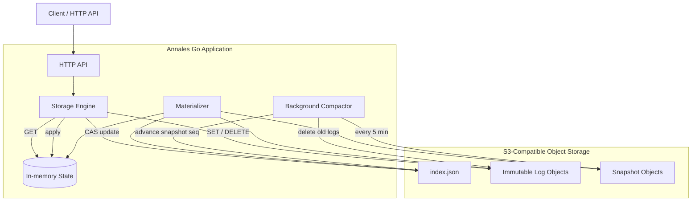

# Annales

**An S3-backed, RAM-first key-value store written in Go.**

Annales keeps the current key-value state in RAM for fast reads, records every mutation as an immutable log object in S3-compatible storage, and reconstructs state from durable storage on restart. A background compactor periodically snapshots state and removes superseded logs.

## Table of contents

- [Architecture](#architecture)
- [How it works](#how-it-works)
- [Getting started](#getting-started)
- [API reference](#api-reference)
- [Configuration](#configuration)
- [Development](#development)
- [Roadmap](#roadmap)
- [Contributing](#contributing)

> **Status:** Experimental. Core persistence, recovery, snapshot compaction, background log cleanup, and multi-instance write consistency are implemented and covered by integration tests. Performance benchmarks remain planned work.

## Architecture



| Component | Responsibility |
|---|---|
| HTTP API | Health and key-value endpoints |
| Engine | Coordinates durable writes and in-memory reads |
| Materializer | Reconstructs RAM state from snapshot + log chain on startup |
| Background Compactor | Snapshots state, advances manifest, deletes superseded logs |
| Manifest (`index.json`) | Tracks current log sequence and snapshot sequence via CAS |
| Log objects | Immutable batches of `SET`/`DELETE` operations |
| Snapshots | Materialized state at a particular sequence |

## How it works

**Read** — served from RAM, no S3 request.

**Write** — append log object → CAS-update manifest → apply to RAM. Retries automatically on concurrent write conflicts.

**Restart** — load snapshot (if any) → replay only logs written after it → RAM is ready.

**Background compaction** — every 5 minutes: serialize current RAM state as a snapshot, advance `CurrentSnapshotSeq` in the manifest, delete all log objects at or below that sequence. Keeps the log chain short and restart time bounded.

## Getting started

### Prerequisites

- Docker Desktop or Docker Engine with Compose
- `curl`

### Run

```bash
chmod +x run.sh
./run.sh
```

Creates `.env` with defaults if absent, builds the image, starts MinIO, initializes the bucket, and starts Annales.

```bash
curl -i http://localhost:8080/health
```

### Write and read

```bash
curl -i -X PUT http://localhost:8080/kv/greeting \
  -H 'Content-Type: application/json' \
  -d '{"value":"Hello from Annales"}'

curl http://localhost:8080/kv/greeting
```

### Stop

```bash
./run.sh down   # removes containers, keeps MinIO data volume
```

**Warning:** `docker compose down -v` deletes the data volume permanently.

## API reference

| Method | Endpoint | Purpose | Response |
|---|---|---|---|
| `GET` | `/health` | Health check | `200 OK` |
| `PUT` | `/kv/{key}` | Create or update | `204 No Content` |
| `GET` | `/kv/{key}` | Retrieve | `200 OK` |
| `DELETE` | `/kv/{key}` | Delete | `204 No Content` |

Missing key returns `404 Not Found`.

## Configuration

| Variable | Purpose |
|---|---|
| `S3_ENDPOINT` | Object-storage endpoint |
| `S3_REGION` | S3 region |
| `S3_BUCKET` | Bucket used by Annales |
| `AWS_ACCESS_KEY_ID` | S3 access key |
| `AWS_SECRET_ACCESS_KEY` | S3 secret key |
| `ANNALES_ADDR` | HTTP listen address (default `:8080`) |
| `MINIO_ROOT_USER` | Local MinIO admin username |
| `MINIO_ROOT_PASSWORD` | Local MinIO admin password |
| `MINIO_API_PORT` | MinIO S3 port (default `9000`) |
| `MINIO_CONSOLE_PORT` | MinIO console port (default `9001`) |

## Development

### Unit and race tests

```bash
go test ./...
go test -race ./...
go vet ./...
```

### Integration tests

Requires Docker. Spins up a dedicated MinIO instance, creates an isolated bucket per test, and tears everything down after.

```bash
./scripts/test-integration.sh
```

`.env.integration` is created automatically with safe defaults on first run. Do not commit it.

### Integration tests in CI

The `integration` job in `.github/workflows/ci.yml` runs the same suite against a MinIO service container on every PR and push to `main`.

### Useful run.sh commands

```bash
./run.sh          # start or rebuild
./run.sh status   # service status
./run.sh logs     # follow logs
./run.sh restart  # restart API container
./run.sh stop     # stop services
./run.sh down     # remove containers, keep data
```

### Data layout

```text
bucket/
├── index.json
├── logs/
│   ├── 1-<uuid>.json
│   └── 2-<uuid>.json
└── snapshots/
    └── snapshot-000002.json
```

## Roadmap

- [x] HTTP API for key-value operations
- [x] S3-compatible append-only log with CAS manifest
- [x] RAM-first reads
- [x] Restart recovery from snapshot + log chain
- [x] Docker Compose deployment with one-command startup
- [x] Automated integration tests against real MinIO (13 tests)
- [x] Deletion recovery and operation ordering across restarts
- [x] Snapshot creation, recovery, and post-snapshot log replay
- [x] Crash injection and recovery from inconsistent storage states
- [x] Concurrent writers and multi-instance consistency
- [x] Background compaction and automatic log cleanup
- [x] Benchmark read latency, write latency, throughput, and restart time
- [x] Compare against Redis and other baselines
- [ ] Operational and security hardening for production use

## Contributing

For changes involving storage consistency, manifest updates, recovery, or compaction, include tests that cover failure conditions as well as the normal path.
