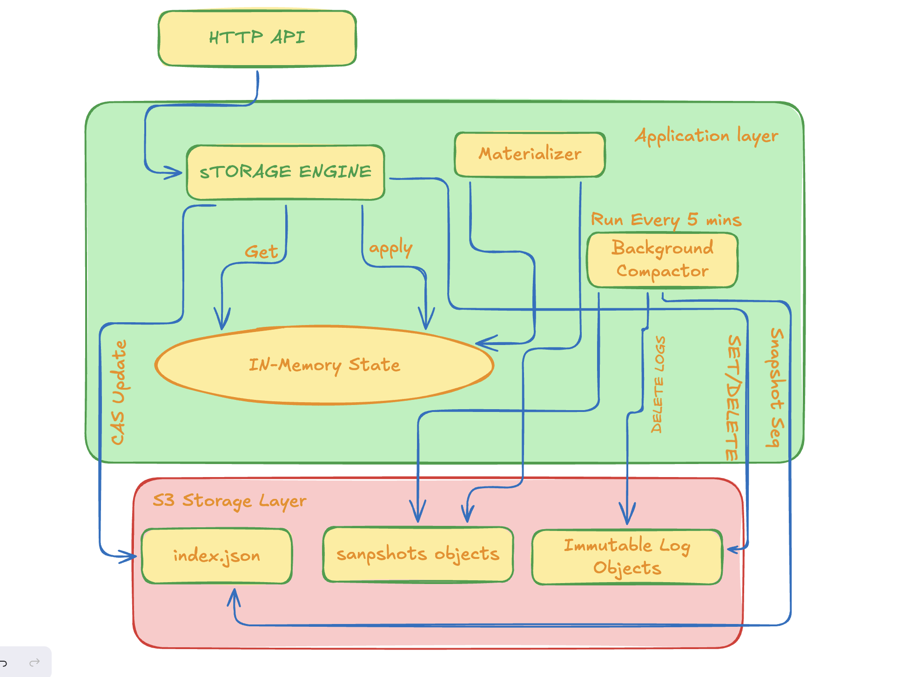

# Building Annales: A RAM-First Key-Value Store on S3-Compatible Object Storage

*Exploring immutable logs, conditional writes, snapshots, and recovery in Go.*

## Introduction

Most key-value stores are designed around local storage, memory, or a distributed storage engine. But what happens when we build a system that serves reads from RAM while using S3-compatible object storage as its durable foundation?

That question led me to build **Annales**, a RAM-first key-value store written in Go.

The idea is straightforward: keep the active key-value state in memory for fast access, while storing durable operations as immutable objects. A small manifest tracks the committed state, and snapshots provide a way to reconstruct the in-memory database after a restart.

For object storage, I use MinIO locally through an S3-compatible API.

This project has been an opportunity to explore a number of practical systems-engineering challenges: concurrent writes, durable commits, recovery, snapshotting, and the trade-offs that emerge when a storage system is built on top of object storage rather than a traditional database engine.

This article explains the architecture, the decisions behind it, and what my initial benchmarks revealed.

## 1. The architecture

Annales separates the in-memory data path from the durable storage path.

At a high level, the system consists of:

- **API layer:** accepts key-value operations.
- **Engine:** coordinates reads, writes, deletes, and state updates.
- **In-memory state:** holds the materialized key-value map.
- **Immutable log objects:** store batches of operations in object storage.
- **Manifest:** identifies the latest committed log position and the current snapshot.
- **Snapshot and materialization components:** save and reconstruct the database state.

The object storage layer is accessed through a Go interface, allowing the engine to depend on storage operations rather than directly on a particular object-storage implementation.

### The write path

A write must do more than update a Go map. If the process crashes, an acknowledged operation should not simply disappear.

Annales uses immutable log objects and a manifest-based commit protocol.

Conceptually, the write path is:

1. The API receives a key-value operation.
2. The engine prepares a log batch.
3. The batch is written as a new, immutable object.
4. The manifest is conditionally updated to identify the new committed position.
5. The engine applies the operation to its in-memory state.

The manifest update is particularly important. Writing a log object alone does not mean that the operation has been committed. The manifest identifies the committed log position, allowing recovery to distinguish committed operations from objects that were uploaded but never committed.

This approach also introduces a trade-off: every durable write may involve object creation and a conditional manifest update. The additional coordination is an important factor to investigate when measuring write throughput.

## 2. Why immutable logs and conditional writes?

Object storage is not a traditional filesystem, and an S3-compatible API does not automatically provide a multi-object database transaction.

Annales therefore uses two different mechanisms for two different responsibilities.

**Immutable objects store history.** Rather than repeatedly modifying one large log file, the system creates separate log objects.

**Conditional writes coordinate commits.** The manifest is updated using a condition that checks the previously observed object version, such as its ETag. If another writer has changed the manifest first, the conditional update can fail, requiring the operation to be retried.

This design provides a way to coordinate competing writers through a shared manifest. However, it does not by itself solve every distributed-systems problem. In particular, multiple running Annales instances would need a defined strategy for keeping their in-memory state consistent with commits made by other instances.

That distinction matters: coordinating durable commits is not the same as maintaining a globally coherent cache.

## 3. Snapshots and recovery

Rebuilding a database by replaying its entire history becomes increasingly expensive as the log grows.

Annales includes a snapshot mechanism to reduce the amount of history that must be replayed.

A snapshot stores a materialized key-value state together with metadata identifying the sequence represented by that state. During recovery, the materializer can restore the snapshot and replay the subsequent committed log chain.

The intended recovery process is:

1. Read the manifest.
2. Locate and load the latest applicable snapshot.
3. Restore the in-memory key-value state.
4. Replay committed operations after the snapshot.
5. Make the reconstructed state available to the API.

The important invariant is that recovery must follow the committed history, not simply replay every log object found in the bucket. An object may exist even though the manifest update that would have committed it failed.

Annales has integration tests covering MinIO conditional writes, concurrent appends, restart and snapshot recovery, and ignoring an uncommitted orphan log.

These tests exercise important correctness scenarios. They are not, by themselves, proof that every possible crash interleaving or multi-instance consistency scenario is safe.

## 4. Initial benchmark results

After implementing the main storage path, I ran an initial benchmark against Annales and Redis.

The Annales write benchmark used 10,000 operations and tested concurrency levels of 10, 50, and 100. I also measured read latency for cache-hit reads.

### Annales write throughput

| Concurrency | Operations | Elapsed time | Reported throughput |
|---:|---:|---:|---:|
| 10 | 10,000 | 29.786 s | 336 ops/s |
| 50 | 10,000 | 28.243 s | 354 ops/s |
| 100 | 10,000 | 30.826 s | 324 ops/s |

The results show that increasing concurrency from 10 to 50 produced only a modest throughput improvement. At concurrency 100, throughput decreased slightly.

One plausible explanation is contention around the shared manifest and the overhead of creating durable log objects. These measurements do not isolate those costs, however, so they should be treated as hypotheses rather than established causes.

The results suggest that adding more concurrent clients did not substantially increase write throughput in this configuration.

### Annales cache-hit read latency

| Metric | Measured latency |
|---|---:|
| P50 | 1.507 ms |
| P95 | 10.465 ms |
| P99 | 16.013 ms |

A repeat run produced similar results: approximately 1.513 ms at P50, 10.727 ms at P95, and 16.005 ms at P99.

The difference between median and tail latency is worth investigating. Possible contributors include client-side scheduling, HTTP overhead, contention, and measurement methodology. More instrumentation would be needed to determine how much each factor contributes.

These numbers describe the observed benchmark environment, not an intrinsic performance limit of the architecture.

## 5. An initial comparison with Redis

For context, I also ran Redis benchmarks.

| Concurrency | Annales writes (ops/s) | Redis SET (ops/s) | Redis GET (ops/s) |
|---:|---:|---:|---:|
| 10 | 336 | 131,579 | 181,818 |
| 50 | 354 | 175,439 | 188,679 |
| 100 | 324 | 204,082 | 204,082 |

The difference is substantial.

But these figures should not be interpreted as a definitive, apples-to-apples database comparison. Annales writes involve an object-storage-backed durability path, while the Redis benchmark uses a different workload and potentially different persistence and durability settings. The benchmark tools and request patterns also differ.

Before drawing quantitative conclusions, I need to make the workloads comparable, validate successful HTTP status codes in the Annales benchmark harness, and document the exact persistence configuration, hardware, and software versions.

The comparison is still useful as an initial observation: **durable writes through an object-storage-backed manifest protocol have very different performance characteristics from the operations measured by a standard in-memory Redis benchmark.**

That difference is a reason to investigate the design and workload more carefully, not a basis for claiming that one system is categorically better than the other.

## 6. A note on the recovery measurement

My initial benchmark reported a recovery time of approximately 2 ms.

On reviewing the benchmark implementation, I found an important measurement limitation: the timer starts when the recovery benchmark process begins polling the health endpoint. It does not start before Annales is restarted.

Consequently, the reported 2 ms is a health-check observation, not a valid measurement of the full restart-to-ready time.

A meaningful recovery experiment should start timing before the service starts, wait for readiness, and verify that previously committed data can actually be read. It should also record how much log data must be replayed and whether a snapshot was available.

I would not use the original 2 ms figure as a recovery-performance result.

## 7. What I learned

Building Annales has highlighted several important engineering lessons.

### Durability has a cost

An in-memory update is inexpensive compared with coordinating a durable commit through object storage. If the application requires durable acknowledgment before returning success, that requirement shapes the write path and its throughput.

### Concurrency does not automatically mean scalability

Adding more clients can increase contention instead of increasing throughput. A shared manifest is a natural place to investigate when multiple writers compete to commit updates.

### Recovery is part of the storage design

Snapshots and immutable logs are useful only when their interaction is well-defined. Recovery must identify the committed history and reconstruct the correct state rather than merely load whatever objects happen to exist.

### Benchmarks need to measure the intended property

A health endpoint responding quickly does not establish that a database has recovered correctly. Likewise, a benchmark that receives an HTTP response has not necessarily completed a successful operation. Measurement code is part of the system being evaluated.

These lessons have influenced how I approach systems engineering: implementation is only one part of the work. Correctness tests, carefully defined measurements, and transparent limitations matter just as much.

## 8. Current limitations and future work

Annales is an engineering project, not a production-ready replacement for established databases.

There are several areas I would investigate next:

- **Benchmark correctness:** count only successful operations and make the workload and durability settings explicit.
- **Recovery measurement:** measure restart-to-ready time and verify recovered data.
- **Manifest contention:** record conditional-write conflicts, retry counts, and object-storage request volume.
- **Snapshot policy:** investigate how snapshot frequency affects recovery time, storage overhead, and foreground performance.
- **Multi-instance behavior:** define and test how in-memory state remains consistent when multiple instances share the same durable store.
- **Storage cleanup:** handle orphaned log objects without deleting objects that are still required for recovery.
- **Failure testing:** exercise more crash points and concurrent interleavings.

These are engineering questions that can be explored incrementally. They do not require claiming a novel database design or turning the project into a formal research paper.

## Conclusion

Annales began as an exploration of a simple idea: keep key-value reads in memory while using S3-compatible object storage as the durable foundation.

Implementing it required more than connecting a Go application to MinIO. The system needed a way to represent committed history, coordinate concurrent writes, reconstruct state after restarts, and test failure scenarios.

The initial benchmarks also exposed the difference between building a functioning system and establishing reliable performance claims. Annales currently has much lower measured write throughput than the Redis benchmark, and its initial recovery timing needs to be corrected before it can support a meaningful recovery claim.

For me, that is part of the value of the project. The goal is not to make every result look impressive. It is to understand the behavior of the system, explain the engineering choices, and improve the implementation based on evidence.

Annales is still evolving, and there is more work to do. But it has already provided a practical way to explore storage abstractions, commit protocols, snapshots, recovery, and the trade-offs involved in building stateful systems on object storage.

---

*Annales is an experimental systems-engineering project. The performance figures in this article are preliminary measurements from the author's benchmark environment and should not be treated as a controlled comparison between databases.*